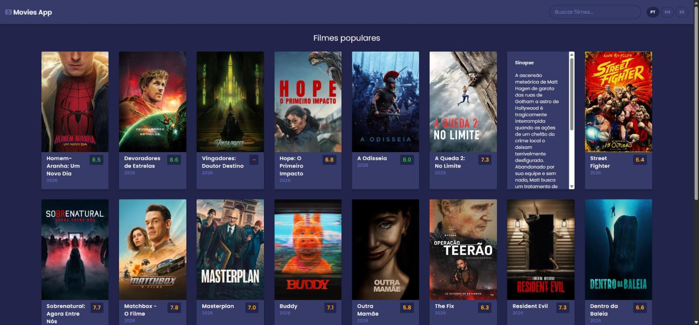

# Movies App (jQuery)

Aplicação simples para listar filmes populares e buscar filmes, feita com **jQuery** e a API do **[TMDB](https://www.themoviedb.org/)**.

🔗 **Demo:** https://maksoud.dev/movies-app-jquery/



## Sobre

Projeto desenvolvido em 2022 durante meus estudos de jQuery. A ideia foi praticar, num projeto pequeno:

- criação de toda a interface pelo JavaScript (o `<body>` do HTML começa vazio);
- manipulação do DOM e tratamento de eventos com jQuery;
- consumo de uma API REST com `fetch` e `async/await`.

A interface foi inspirada [neste tutorial](https://www.youtube.com/watch?v=dtKciwk_si4&t=1870s), originalmente escrito em JavaScript puro e reescrito aqui com jQuery.

## Funcionalidades

- Lista dos filmes mais populares do momento
- Busca de filmes pelo título
- Botão "Carregar mais" para paginar os resultados
- Nota de cada filme colorida (verde ≥ 8, laranja ≥ 5, vermelho < 5) e ano de lançamento
- Sinopse que aparece ao passar o mouse, ao tocar no card (celular) ou ao navegar com Tab
- Títulos, sinopses e textos da interface em português, inglês ou espanhol
- Imagem padrão quando o filme não tem pôster
- Mensagens de carregamento, de erro e de "nenhum filme encontrado"
- Layout responsivo

## Tecnologias

- HTML5 e CSS3 (CSS Grid, variáveis CSS)
- JavaScript (ES6+)
- [jQuery 3.5.1](https://jquery.com/) (arquivo local)
- [TMDB API v3](https://developer.themoviedb.org/docs) (`/discover/movie` e `/search/movie`)
- [Font Awesome](https://fontawesome.com/) e fonte [Poppins](https://fonts.google.com/specimen/Poppins)

## Estrutura

```
movies-app-jquery/
├── index.html           # Página base: carrega o CSS, o jQuery e o script
├── script.js            # Monta a interface, chama a API e renderiza os filmes
├── style.css            # Estilos
├── jquery-3.5.1.min.js  # jQuery
├── img-default.jpg      # Imagem usada quando o filme não tem pôster
├── screenshot.jpg       # Print usado neste README
└── favicon.ico
```

## Como rodar

Não há build nem dependências para instalar. Basta abrir o `index.html` no navegador, ou servir a pasta com qualquer servidor estático:

```bash
npx serve .
# ou
python -m http.server
```

## Observação

A chave da API do TMDB fica no `script.js`, porque é um projeto só de front-end. Para estudos isso não é problema, mas em um projeto real o ideal é fazer as chamadas por um back-end para não expor a chave.

---

Outros projetos: https://maksoud.dev/projetos/
